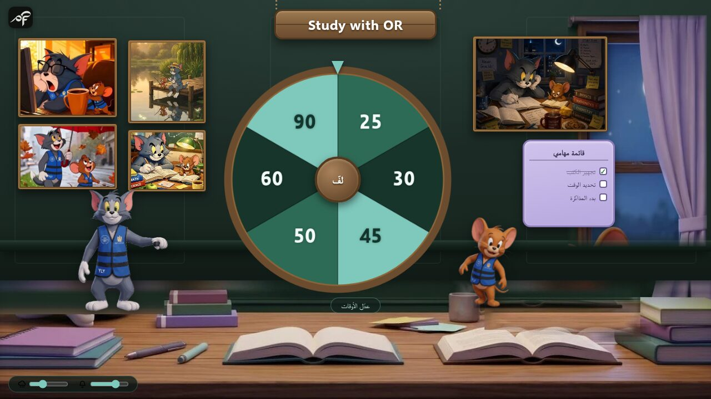
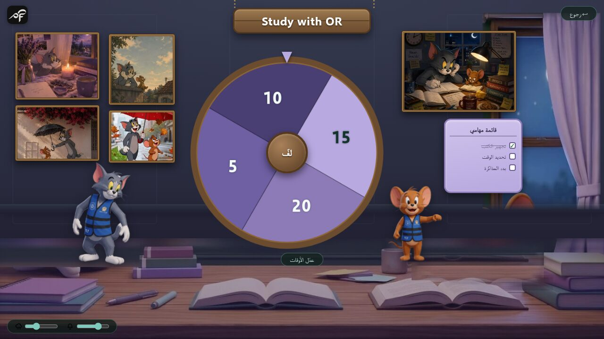

# Study with OR

A Tom & Jerry themed study companion with a spin wheel, focus timer, and a session checklist.
**Live demo:** https://mahmoudfouad10.github.io/study-with-or/





## Key Features

- **Spin wheel sessions** - spin to pick a study session (25/30/45/50/60/90 min) or a rest break (5/10/15/20 min); the pointer always lands on the drawn result.
- **Focus timer** - manual start, pause and reset, a chime when time ends, and the characters freeze with you while you work.
- **Full session flow** - study wheel leads into the study timer, then the rest wheel, then the rest timer.
- **Editable times** - the "عدّل الأوقات" button lets you change every slice on the current wheel (1-180 min each).
- **Session checklist** - a small to-do panel (قائمة مهامي) for the steps of your session.
- **Tom & Jerry room** - animated poses while the wheel spins, picture frames that enlarge on click (Esc closes), and separate volume sliders.
- **Works on phone and desktop** - dedicated compact layout for small screens, Arabic RTL interface.

## Tech Stack

- HTML5, CSS3, vanilla JavaScript - no frameworks, no build step
- Canvas API for the wheels, Web Audio API for the chime and spin sounds
- Images as compressed WebP, intro as an MP4 loaded at runtime
- Hosted on GitHub Pages straight from this repo

## Run Locally

1. `git clone https://github.com/mahmoudfouad10/study-with-or.git && cd study-with-or`
2. Serve the folder with any static server, e.g. `python3 -m http.server 8000`, then open http://localhost:8000

(A static server is needed because the intro video is fetched at runtime; opening index.html directly from disk skips the intro.)

## Project Structure

```
index.html    page markup + meta/Open Graph tags
style.css     all styling, including the phone layout
app.js        wheel drawing + spin logic, timer, poses, lightbox, sound
assets/       WebP images, logo, intro.mp4, og.jpg (link-preview image)
docs/         screenshots used in this README
```

## Editing the Session Times

- In the page: click "عدّل الأوقات" under the wheel, edit the values, confirm.
- In the code: the defaults live at the top of `app.js` in `S.studyVals` and `S.restVals`.

## Publishing

The site is served by GitHub Pages from the `main` branch root: push to `main` and
https://mahmoudfouad10.github.io/study-with-or/ updates within a minute or two.

## Roadmap

- Lazy-load the spin-pose frames and the artwork of the inactive mode to cut first-load weight further
- Offline support with a service worker
- Optional color themes beyond the current forest-green / lavender pair
- Session history (completed study/rest rounds) kept in localStorage
