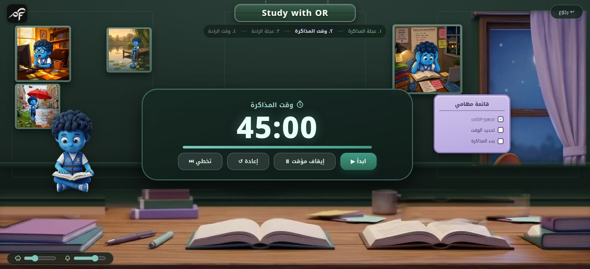

# Study with OR

A study companion with a friendly blue mascot, a spin wheel, a focus timer, and a session checklist.
**Live demo:** https://mahmoudfouad10.github.io/study-with-or/

## Key Features

- **Spin wheel sessions** - spin to pick a study session (25/30/45/50/60/90 min) or a rest break (5/10/15/20 min); the mascot pushes the wheel and the pointer always lands on the drawn result.
- **Focus timer** - manual start, pause and reset, a chime when time ends, and the mascot celebrates with you when you finish.
- **Full session flow** - study wheel leads into the study timer, then the rest wheel, then the rest timer.
- **Editable times** - the "عدّل الأوقات" button lets you change every slice on the current wheel (1-180 min each).
- **Session checklist** - a small to-do panel (قائمة مهامي) for the steps of your session.
- **Animated mascot room** - original blue YLY mascot brought to life with transparent WebM video loops (with poster fallback), picture frames that enlarge on click (Esc closes), and separate volume sliders for rain and chime.
- **Works on phone and desktop** - dedicated compact layout for small screens, Arabic RTL interface.

## Tech Stack

- HTML5, CSS3, vanilla JavaScript - no frameworks, no build step
- Canvas API for the wheels, Web Audio API for the chime and rain ambience
- Transparent VP9 WebM video with PNG poster fallback, images as compressed WebP
- Hosted on GitHub Pages straight from this repo

## Run Locally

1. `git clone https://github.com/mahmoudfouad10/study-with-or.git && cd study-with-or`
2. Serve the folder with any static server, e.g. `python3 -m http.server 8000`, then open http://localhost:8000
